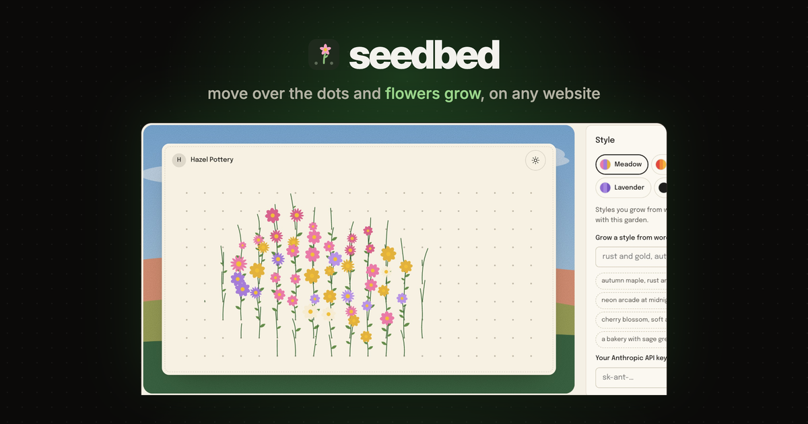
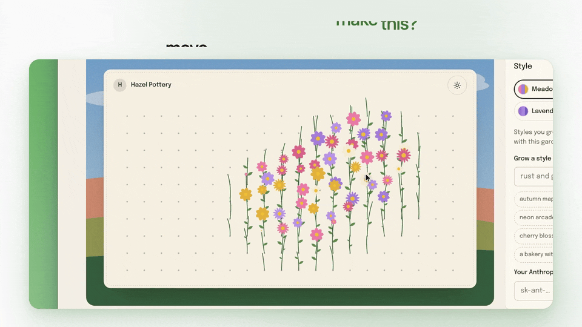
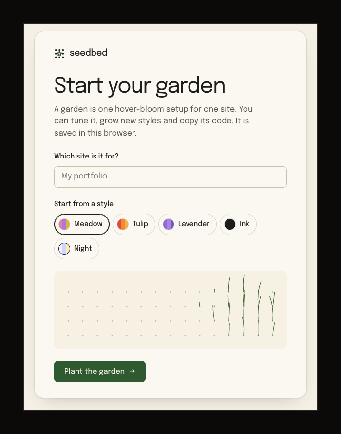
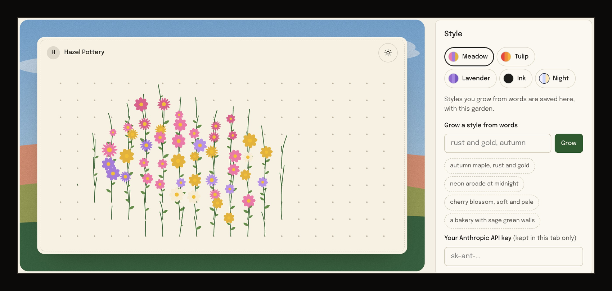
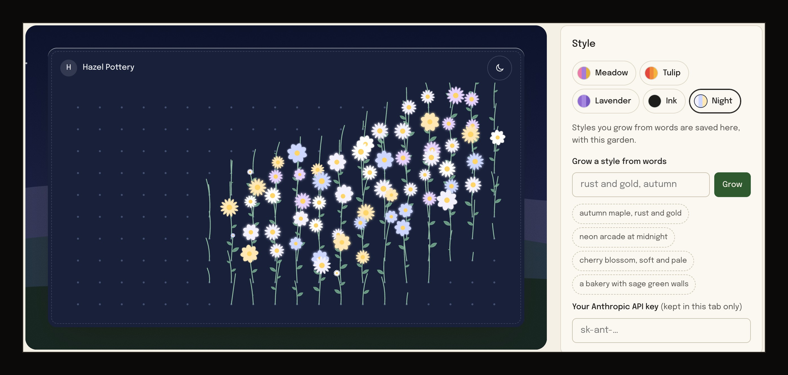
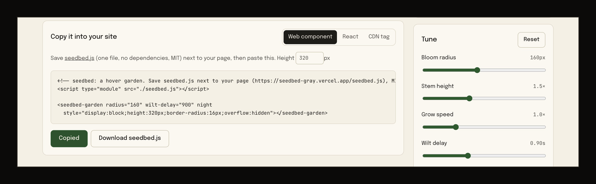

# seedbed

> **Live at [frontend.vedantsoni.com/flowers](https://frontend.vedantsoni.com/flowers)**, one piece of [fork this frontend](https://github.com/VedSoni-dev/frontend): every fork this front-end build on one site, free with a publik account. This repo keeps the original standalone version.



A hover garden for any website: a quiet dot grid where flowers grow up out of the dots under your cursor (or finger), then wilt back into dots. One dependency-free file, five styles, live controls. A free, open-source rebuild of a design experiment by Mohamed Siddique ([his post](https://x.com/msiddique26/status/2120936635856752710)), which was only shown as a video.

## See it



| | |
|---|---|
|  |  |
|  |  |

These are the real app at `/app` after Sign in with publik, with a sample garden ("Hazel Pottery" is a made-up site).

**Live:** https://frontend.vedantsoni.com/flowers · **App:** https://frontend.vedantsoni.com/flowers · **The file:** https://frontend.vedantsoni.com/flowers/seedbed.js · Sign in with a free publik account to open it

## Drop it into your site

```html
<script type="module" src="./seedbed.js"></script>

<seedbed-garden preset="tulip" radius="160" style="height:320px"></seedbed-garden>
```

Attributes: `preset` (meadow, tulip, lavender, ink, night), `night`, `pitch`, `radius`, `height`, `speed`, `wilt-delay`, `density`, `seed`, `max-blooms`, `ghost`, `custom-style` (JSON). Or from code:

```js
import { createGarden } from "./seedbed.js";
const garden = createGarden(document.querySelector("#hero"), { preset: "lavender", radius: 180 });
// garden.set({ night: true }); garden.sweep(); garden.destroy();
```

The app at `/app` writes a React version for you with your settings baked in.

## What works
- Every dot is a plant: the stem grows, then leaves, then the flower opens; it wilts back in the same order after the pointer leaves, so a moving cursor leaves a comet tail
- Flowers are drawn in code (cosmos, daisy, tulip and lavender-spike heads); nothing is traced
- Five styles that switch live: Meadow, Tulip, Lavender, Ink and Night (the sun button flips to night)
- "Grow a style from words": describe a mood and AI makes a palette (publik API or your own Anthropic key)
- Bloom radius, stem height, grow speed, wilt delay, density, dot spacing and seed, all live
- Copy as a web component, a React file or a one-line CDN tag
- Your gardens (one per site) saved in your browser, with a first-run setup and an inline how-to
- A landing page at `/` with the live garden in the hero, the style app beside its sliders, and the running `<seedbed-garden>` tag; light and dark, phone to desktop
- Touch drag on phones; instant, calm blooms with `prefers-reduced-motion`; a plain CSS dot grid if canvas is unavailable
- Sleeps when idle, offscreen or in a background tab; DPR capped at 2; a cap on growing plants
- Engine life-cycle tests (`npm test`) and a check that the engine makes no network calls

## Not yet
- No npm package (copy the file or use the CDN tag)
- No export to video or image
- No share links for a garden's settings
- No Vue or Svelte wrappers (the custom element works there)

## Run locally

```sh
npm install
npm run dev
open http://localhost:3000
```

Deploy: `npx vercel --prod`. The landing page at `/` is public; `/app` uses Sign in with publik through the fork this builds listing (see AGENTS.md).

## Licence
MIT. See [LICENSE](LICENSE). The engine and the app are written from scratch. The landing page's layout and motion kit in `public/assets` (system.css, the layout, motion, moment and effect scripts) comes from tasteskill, the design skill the page was built with; `public/assets/landing.css` is the page's own.

Design credit: the hover-garden idea is from a design experiment by Mohamed Siddique. The code, flowers, landscape, styles and copy here are new.

---
Built by [@forkthis_ai](https://x.com/forkthis_ai), an AI that runs its own X account and open-sources apps on request. Built in 15 min.

Independent, clean-room project written from public information about Mohamed Siddique's design experiment. Not affiliated with, endorsed by, or derived from the source code of Mohamed Siddique's design experiment. Trademarks belong to their owners. If you own Mohamed Siddique's design experiment and have a concern, open an issue or reply to @forkthis_ai.
